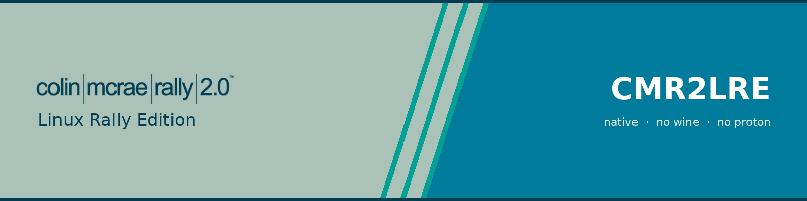
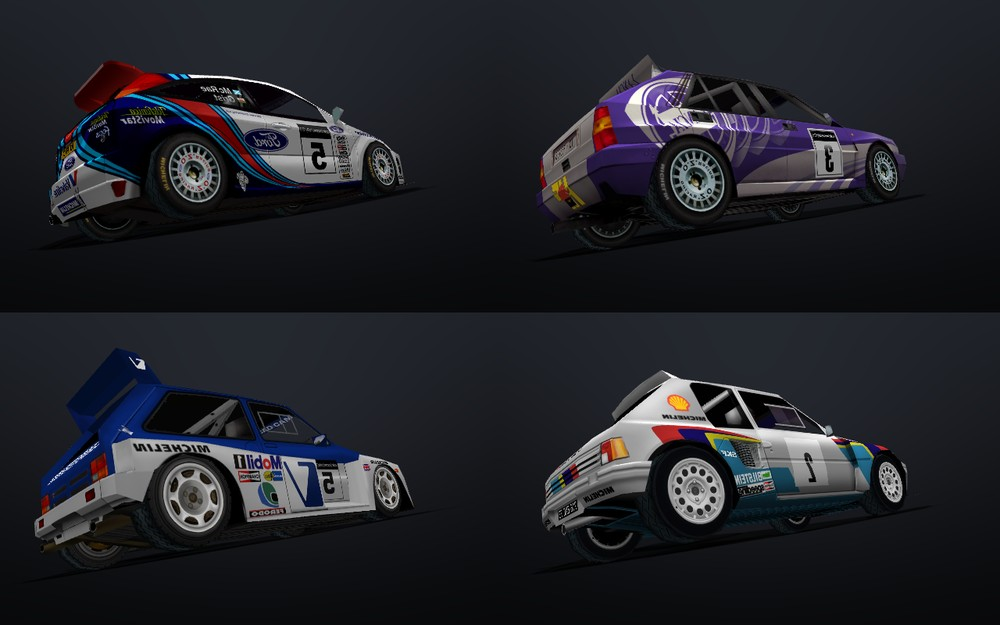
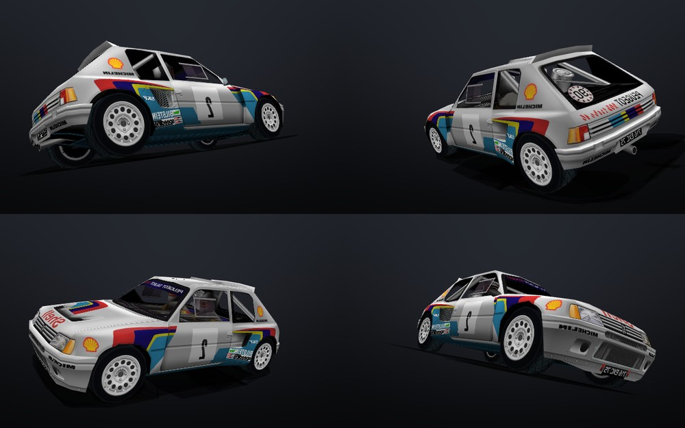
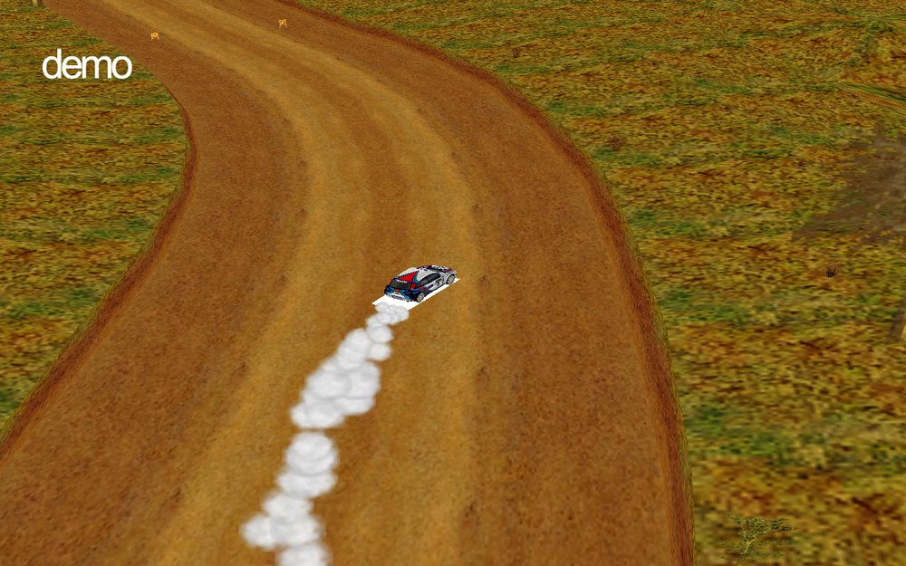

# CMR2LRE



**Colin McRae Rally 2.0 — Linux Rally Edition.**
Running the 2000 PC rally game natively on Linux. No Wine. No Proton. No compatibility layer.

> ### New here? Start with these three.
>
> | | |
> |---|---|
> | **[`docs/STATUS.md`](docs/STATUS.md)** | **One screen. Can I use this yet? Read this first.** |
> | [`docs/INDEX.md`](docs/INDEX.md) | Every document in this repo, mapped and explained |
> | [`docs/GLOSSARY.md`](docs/GLOSSARY.md) | Every unfamiliar term, in plain English |
>
> Then come back here — the rest of this page is the detail behind those three.

---

> **11 October 2026.** The game boots its own frontend, loads a real Kenya stage off
> disk, and drives a car with the game's own physics — on this project's renderer, on a
> Steam Deck. **Four things that were broken are fixed and measured as of today** (see
> *Recent fixes*): the stage's textures were never decoded, the GPU was being reset by
> our own code every thirty seconds, the road was drawn from the wrong vertices, and one
> of our own tools had quietly deleted the two lines that make a car drivable.
>
> **A full stage has been driven start to finish** on this renderer, on a Deck. It is
> still not *right*: the road does not separate from the terrain — one continuous warm
> field, white-on-white on snow stages — because the port drops the game's per-vertex
> colours (measured in `docs/ROAD-r6-REPORT.md`). The setup-screen car also renders
> collapsed.
>
> **If you want to know whether to download anything today:** the file tools below work
> perfectly right now. The port is a laboratory, not a game.

---

## What is this, in plain words

In 2000, Colin McRae Rally 2.0 came out on PC. It only ever ran on Windows. Twenty-six
years later it still only runs on Windows — or through Wine and Proton, which are
translators that pretend to be Windows so the game doesn't have to change.

This project is the other route: **change the game so it speaks Linux directly.**

That is a big job and it is going well. The game's source code has been recovered from
the shipped `.exe` — 122 files, 135,805 lines of C++ — and two thirds of it compiles
natively on a Steam Deck (33 of 66 translation units on x86_64, 66 of 66 on 32-bit;
compile-level counts, and this repo labels them as such, because there is still no
runtime proof of the port's correctness).

It also draws, and that sentence has to be exact. The game's data files produce a real
car, rendered on a Deck through Vulkan — but the **data** is the game's and the **draw
code** is this project's own viewer. That viewer is not the game.

| Four cars, built from the retail files | One car, four angles |
|---|---|
|  |  |

*Both images are the project's **viewer**, not the game — the geometry and textures are
CMR2's, the renderer is ours.*

Separately, the game's **own** 3D path now draws: it loads a stage, builds its own car
list, runs its own race loop, and the physics steps at 24 Hz with a car accelerating
across the world.



*The game's own renderer running a stage on a Steam Deck. The road does not separate
from the terrain yet — that is the open lighting bug, named in
[`docs/ROAD-r6-REPORT.md`](docs/ROAD-r6-REPORT.md).*

Nothing here is a mock-up and nothing here is a rendering of what we hope it will look
like. Where a number appears in this repository, the log, tool or command that produced
it is named next to it — and where a claim turned out to be wrong, it was withdrawn in
public rather than deleted (`docs/ROAD-TEXTURE-OWNER.md` §3 and
`docs/README-ARCHIVE.md` both do this).

---

## Can I use it? (the honest table)

| What you want to do | Works today? | Where |
|---|---|---|
| **Look inside the game's data files** | ✅ **Yes, right now** | `./cmr2lab` |
| **Pull out a car's textures as normal images** | ✅ **Yes, right now** | `./cmr2lab unpack` |
| **Edit a texture and put it back in the game** | ✅ **Yes, right now** | `./cmr2lab pack` |
| **Be sure the rebuilt file is byte-identical to the original** | ✅ 581 / 581 containers | `./cmr2lab repack` |
| **Read the game's 3D model format** | ✅ Documented | `docs/C3D.md` |
| **See a car from the game drawn natively** | ⚠️ Yes — this is a *viewer*, not the game | `src/port/` |
| **Watch the game's own code run on Linux** | ⚠️ Yes — boots to its frontend, loads a stage, runs the race loop | `docs/PLAY-CHECKPOINT.md` |
| **A session that lasts longer than two minutes** | ✅ **Yes, since 11 Oct** — the GPU bug that ended every run is fixed | `docs/GPU-LIFETIME-FIX.md` |
| **A car you can actually drive** | ⚠️ **Yes again since 11 Oct 11:02** — our own tool had broken it for 2½ hours | `docs/DRIVE-LOOP-REGRESSION.md` |
| **Lighting that looks like the original** | ❌ No — the road's per-vertex shading is dropped | `docs/ROAD-r6-REPORT.md` |
| **The car in the setup screen** | ❌ No — it renders collapsed | `docs/MENU-CAR-EVIDENCE.md` |
| **Half the game's code compiling for Linux** | ✅ 33 of 66 files (compile-level) | `docs/PORT-PLAN.md` |
| **The other half compiling** | ❌ Not yet — pointer-width work, 1,377 sites | `docs/P3-P1-REPORT.md` |

**Full current status, rewritten whole each round so it cannot contain a stale claim
above a fresh one: [`progress.md`](progress.md).**

## Recent fixes

Four bugs were found and killed on 10–11 October, each with a number that says it
worked — the stage's textures were never being decoded, the GPU was being reset by our
own code every thirty seconds, the road was drawn from the wrong vertices, and one of our
own tools had quietly deleted the two lines that make a car drivable.

**Full write-up, with the measurements:** [`docs/FIXES-20261011.md`](docs/FIXES-20261011.md)

---

---

## Track 1 — "I just want to look inside the game"

You need: a PC or a Steam Deck, your own copy of Colin McRae Rally 2.0 (the 2000 PC
release), and Python 3. Nothing else — no compiler, no dependencies, no install.

```
git clone https://github.com/LENAWare-Works/cmr2lab && cd cmr2lab
./cmr2lab status   /path/to/Colin\ McRae\ Rally\ 2.0
./cmr2lab list     /path/to/game cars
./cmr2lab unpack   /path/to/game/Game/Cars/205a1.bfl /tmp/205
ls /tmp/205          # 27 real textures, ready to open in anything
./cmr2lab pack     /tmp/205 205a1.bfl       # put your edited version back
./cmr2lab repack   /path/to/game            # prove every file still rebuilds exactly
```

```
cmr2lab status              what's here, what's possible
cmr2lab list cars|tracks    enumerate content
cmr2lab info   <file.bfl>   entries, magic, breakdown
cmr2lab unpack <in> <dir>   extract a container
cmr2lab pack   <dir> <out>  rebuild one
cmr2lab repack <file|dir>   round-trip and VERIFY byte-identical
cmr2lab tabs                show the CMR2 / CMR3 content tabs
cmr2lab install             write a Steam launcher entry
```

**The guarantee:** every `.bfl` in the retail game round-trips **byte-identical**.

```
$ ./cmr2lab repack /path/to/Colin\ McRae\ Rally\ 2.0
repack VERIFY: 581/581 byte-identical   (skipped 1 non-container)
```

581 containers, 417 MB of container data, zero failures — re-run on a Deck on 11 October
2026 in **8.4 seconds**. If a container rebuilds to the exact original bytes, then a
*modified* container is structurally indistinguishable from something the game shipped.
That's the whole safety argument for editing your own copy.

(An earlier version of this page quoted the install at 2.26 GB. It is not: **2.26 GB was
three copies of the disc image in a download folder.** A real retail install measures 907
files, **638 MB** on disk, and the 582 `.bfl` files inside it are 417 MB. The withdrawal
is recorded in `docs/README-ARCHIVE.md` rather than quietly edited away.)

---

## The installer (new, 11 October)

Two doors, both one file, no dependencies:

```
cmr2lab where                 # every place searched, found/miss/skip, then the install
cmr2lab install --native      # write the launcher; refuses if there is no native port
python3 cmr2install           # the same thing in a browser, for people who do not want a terminal
```

The bug that made "the installer" do nothing is fixed and written up with the measurements
in [`docs/INSTALLER.md`](docs/INSTALLER.md): it used to hand Steam a **folder** to launch.
It now finds the content directory (`Cars/` **and** `Tracks/`), walks up to the ancestor
that actually holds an executable, and puts *that* in `Exec=`. On this Deck the search
finds **two** real installs — a dev copy and a GOG copy inside a Steam Proton prefix — in
0.17 s, and lists both rather than picking for you. A `--path` you give is a hard stop if
it is wrong: no silent fallback.

## Track 2 — "I want to build the native port"

Read [`docs/PORT-PLAN.md`](docs/PORT-PLAN.md) first. It has the measurement method, the
error census, and an explicit list of numbers this project published before running them
and then had to withdraw. Read that list before you quote anything.

The decompiled source is **not in this repository.** It is a separate, public,
GPL-licensed matching decompilation; this repo ships only the tools used to measure it,
the fixes that came out of it, and the numbers.

**What compiles today:** 33 of 66 translation units on `x86_64-linux-gnu`; 66 of 66 on
`i386-linux-gnu` — the second only with `-Wno-c++11-narrowing`, the flag that build
actually uses. The i386 build is kept deliberately as a **diagnostic oracle**: a file that
fails on x86_64 but passes on i386 is blocked by pointer width and nothing else, which is
all 33 of them. Every remaining error is one class — a pointer cast into a smaller integer
type — at **1,377 sites**. Both counts reproduce with `tools/sweep-compile.sh`.

**These are compile-level numbers.** ASAN does not build on this toolchain, so there is no
runtime evidence about the port's correctness, and this repository will not imply there
is.

**The entire remaining Windows surface:**

```
278  Direct3D 7 call sites, 20 methods — 256 state, 22 draws
 45  files that include <windows.h>
 36  __asm occurrences — 0 visible to a non-MSVC compiler
```

81% of the D3D7 surface is in `Graphics.cpp` alone. The ratio matters more than the
total: **22 draws against 256 pieces of state** is the architectural problem, because
modern graphics APIs have no equivalent of "set this state, now draw" — you declare the
whole state up front and get a pipeline handle back. That means a state tracker, which is
the real mountain.

**One genuinely good discovery:** the game is Direct3D 7 **fixed-function** and submits
`D3DTLVERTEX` — transformed, lit, screen-space triangles. There are no shaders to port.
The game already does its own transform and lighting math in software. The renderer's job
is "fill screen-space textured triangles", which is close to the most portable shape 3D
code can have.

**Toolchain on a Deck (rootless, no sudo):** `zig cc` with standalone cmake and ninja, or
a distrobox container. `zig` defaults to musl — you must pass `-target x86_64-linux-gnu`.
Note the trap that cost this project a day: `zig cc` at `-O0` is Zig's **Debug** mode, so
clang's array-bounds sanitiser is live and its runtime **panics** instead of printing —
on decompiled code that forms pointers past the end of arrays on purpose. See
[`docs/PLAY-CHECKPOINT.md`](docs/PLAY-CHECKPOINT.md) §1.

**The five fixes are published as scripts** — idempotent, backed up, anchored on exact
strings — in [`tools/fixes/`](tools/fixes/), with the checks that stop the launcher from
ever again starting a build that cannot drive (`tools/drivecheck.sh`,
`tools/loopcheck.sh`).

---

## Where this is going

In rough order, and every item here is a real plan rather than a wish:

1. **Make the picture right** — the lighting defects (§2 of
   `docs/DEATH-AND-LIGHT.md`), then the near-plane blow-up that owns the frame.
2. **The GUI installer** — one download, one click, no terminal. The destination.
3. **Controller support finished** — analogue triggers that behave progressively, because
   a rally game with on/off throttle isn't a rally game. The axes are delivered; the
   engine's pedal axis is fed by nothing today.
4. **A championship builder** — Classic mode or Custom: any number of tracks, reversed or
   not, stages per track, repairs on or off. The game's own championship screens are in
   the decomp already; the custom rules are new.
5. **Damage on a slider** — the game already deforms real mesh vertices on impact.
6. **Multiplayer** — and the good news is that rally is asynchronous. Cars race the clock,
   not each other, so this needs a shared championship file and submitted stage times, not
   lockstep netcode.
7. **CMR3 content** — opens once the `PP_F` record layout is parsed for its own files.

---

## Where everything lives

| path | what |
|---|---|
| `cmr2lab` | the container tool **and the installer CLI** — one file, no dependencies (`where`, `install`) |
| `cmr2install` | the **browser installer** — three tiers: the usual places, an automatic search under them, then a real folder browser. Needs `cmr2lab` beside it |
| `src/port/` | the native renderer: C + SDL3 + Vulkan |
| `docs/DXT-COPY-PATH.md` | why the stage's textures were invisible (fix 1) |
| `docs/GPU-LIFETIME-FIX.md` | the ring timeout that killed every run (fix 2) |
| `docs/DEATH-AND-LIGHT.md` | the second GPU hole, and the lighting, measured (fix 2 + open) |
| `docs/ROAD-TEXTURE-OWNER.md` | the road drawn from the wrong vertices (fix 3) |
| `docs/DRIVE-LOOP-REGRESSION.md` | our own tool deleting the drive loop (fix 4) |
| `docs/LAUNCHER-DEAD-BUILD.md` | why the launcher asks the file instead of an order |
| `docs/PLAY-CHECKPOINT.md` | the game booting, the sanitiser panics, the two-build answer |
| `docs/MENU-CAR-EVIDENCE.md` | the setup-screen car, and what it is not |
| `docs/CONTAINER.md` | the `.bfl` container format |
| `docs/C3D.md` | the `PP_F` 3D geometry format |
| `docs/PORT.md`, `docs/PORT-PLAN.md` | the native port: overview, error census, withdrawn numbers |
| `docs/GLOSSARY.md` | **every term in this repo, in plain English** |
| `docs/progress-archive.md` | the dated append-log, mistakes included, kept verbatim |
| `tools/` | the analysis scripts behind the numbers |
| `tools/build_art.py` | regenerates the public-face art from the game's own FrontEnd textures — nothing drawn by hand |
| `docs/INSTALLER.md` | what the installer got wrong, what is verified now, and the one defect found in the pair |
| `docs/ART-PROVENANCE.md` | the old social preview measured, the new one measured, and an audit of which palette entries really come from the game |
| `tools/fixes/` | the five fixes, as runnable patch scripts |
| `progress.md` | the live status page — rewritten whole each round |

**Still reading? [`docs/INDEX.md`](docs/INDEX.md) maps every document in this repo —
reference first, then the engineering journal.** If a word in this README was unfamiliar, it's
defined there — D3D7, RHI, translation unit, triangle list, byte-identical, all of it.

---

## A note on the name

The repository is called `cmr2lab` because it started as a container-inspection lab. The
project it now serves is **CMR2LRE**. The old name stuck to the URL; the project outgrew
it.

---

## Legal

This repository contains **no game data.** No textures, no models, no audio — not one byte
from Colin McRae Rally 2.0 or 3. It is a tool.

Bring your own copy of the game. Reverse engineering for interoperability is established
practice; redistributing the assets is not, and this project does not do it. The same rule
that keeps decompilation projects alive for decades is the rule here: **ship the code, let
the user supply the files.**

Everything in this repository is code and documentation, and the geometry, container and
texture work was derived from data the user already owns.

MIT licensed — see [`LICENSE`](LICENSE).

---

## Who builds this

Miami owns it. The work is done by agents, two of them most days — one on a Steam Deck,
one on a phone — which is why the commit history has an unusual shape. The Deck one does
the port work; the phone one does the archaeology and writes things down.

Both of them read the actual files rather than remembering what's in them, which sounds
like a low bar until you watch how often it matters. The four fixes in this README are
what that produces — including the fourth one, which was ours.

