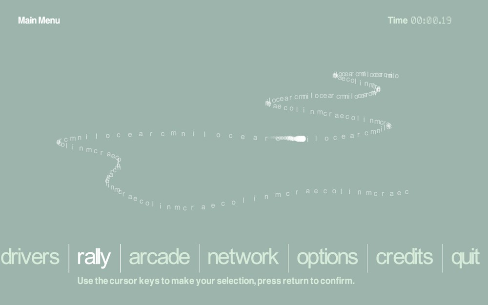

# Status — can I use this yet?

**Short answer: it runs and you can drive a stage. It does not look right yet.**

CMR2LRE (Colin McRae Rally 2.0: Linux Rally Edition) is a from-scratch native port of
the 2000 PC rally game to modern Linux, aimed at the Steam Deck. It is **in progress** —
a working game with one big known visual defect.

## What works today

- Launch it. A window opens, the frontend loads, the menu car renders.
- A full stage loads and runs — car physics, terrain, a real race from start to finish.
- **The recipe:** launch, then **do not touch anything for ~30 seconds.** The attract
  demo walks itself into a race. *Pressing a key parks it on the frontend — that is not
  a crash, it is the wrong door.*

*The game's own frontend, running natively on a Steam Deck.*

## What is broken (and why it looks like it does)

**The road does not separate from the terrain.** Every stage renders as one continuous
warm field — road, verge, sunlit and shadowed ground all merge. On snow stages (Sweden)
this becomes white-on-white and is effectively undrivable.

This is a **lighting bug, not a geometry bug.** The game colours its terrain per-vertex;
the port currently discards those vertex colours and shades everything as
`texture × white`. The measurement is in `docs/ROAD-r6-REPORT.md`; the fix is the next
build.

## Where this is going

`docs/WHERE-THIS-IS-GOING.md` is the roadmap. The immediate next item is the
vertex-colour fix, which should separate road from verge and make Sweden drivable.

## If you just want to play the original

Use Proton on Steam. This port is a reverse-engineering project, not yet a finished
replacement.
